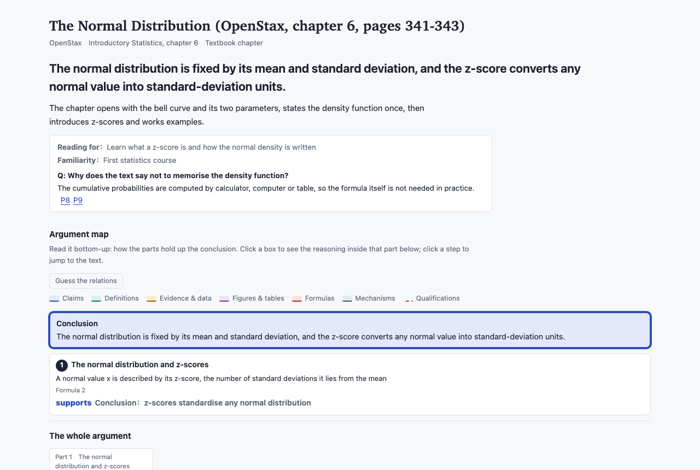
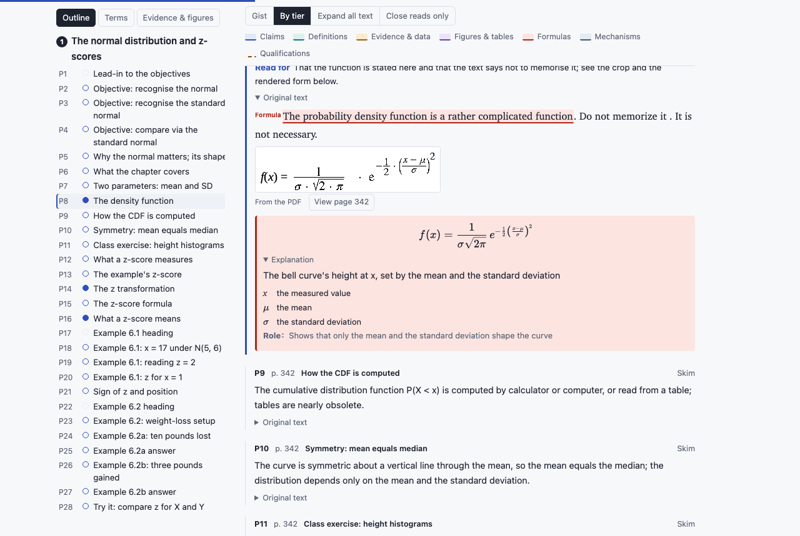

English | [中文](README.zh.md)

# reading-guide

**Turn a course reading into a page that teaches you how to read it.** Give an AI agent a PDF; get back one offline HTML page with the argument mapped, every paragraph sorted into close read / skim / skip, the key sentences highlighted in the original, formulas and tables cropped from the PDF and explained, and recall questions at the end of each part. Notes in English or Chinese.





The demo pages above come from an OpenStax statistics chapter (CC BY). The skill follows the open [Agent Skills](https://agentskills.io) format, so it works in any agent that supports skills; the scripts are plain Python and the page is a single file that works offline.

## Installation (30-second setup)

<details open>
<summary><b>Claude Code</b></summary>

```bash
git clone https://github.com/Liangzhen-Chen/literature-guide-read ~/.claude/skills/reading-guide
pip install -r ~/.claude/skills/reading-guide/requirements.txt
```

Then open any project, attach or name a PDF, and say "give me a reading guide for this".
</details>

<details>
<summary><b>Codex</b></summary>

```bash
git clone https://github.com/Liangzhen-Chen/literature-guide-read ~/.codex/skills/reading-guide
pip install -r ~/.codex/skills/reading-guide/requirements.txt
```
</details>

<details>
<summary><b>Any agent that supports Agent Skills (Cursor, Copilot, Gemini CLI, …)</b></summary>

```bash
npx skills@latest add Liangzhen-Chen/literature-guide-read
pip install pdfplumber
```

The installer asks which agents to install to; `-g` installs for your user instead of the current project.
</details>

<details>
<summary><b>claude.ai</b></summary>

Zip the folder and upload it through the Skills control if your plan has one. Only the default extraction tier runs there (the sandbox cannot download models); scans and formula-heavy readings do better in a local agent.
</details>

<details>
<summary><b>By hand, with any chat model</b></summary>

Run the scripts yourself; the model only writes the guide data.

```bash
pip install -r requirements.txt
python scripts/segment.py reading.pdf --out work
```

Give the model the files in `references/` and `work/paragraphs_part*.txt`, with this prompt:

> Write guide data for this reading. The rules are in method.md, elements.md and genres.md; the format is in schema.md. The text is already split into numbered paragraphs: use those ids and do not re-split. Read every paragraph first, then follow method.md. Write the notes in [Chinese/English]. Output only two JSON blocks, saved as guide.json and paras_01.json. Copy every anchor verbatim from the original.

Save the two blocks into `work/`, then:

```bash
python scripts/check.py work/paragraphs.json work/guide.json work/paras_01.json
python scripts/render.py work/paragraphs.json work/guide.json work/paras_01.json --out work/guide.html
```

If `check.py` reports errors, paste them back to the model and ask it to fix them.
</details>

**Optional, for scans and formula-heavy readings:** Tesseract (`eng`, `chi_sim`) and Poppler for OCR; [MinerU](https://github.com/opendatalab/MinerU) for layout analysis (`pip install "mineru>=4,<5" && mineru-kit models download --tier basic`, about 0.8 GB, CPU is fine). `segment.py` uses MinerU automatically when it is installed; see [Extraction tiers](#extraction-tiers).

## Usage

1. Give the agent a PDF and ask for a reading guide.
2. It asks one round of questions first: the language of the notes, what you are reading for (the whole argument, core claims only, method and design, evidence to cite, exam revision), how familiar you are with the field, and any questions you want answered. Say "you decide" to take the defaults.
3. It segments the PDF, reads everything, writes the guide, validates it and hands you the page.

What you get on the page:

- **Your brief** at the top: purpose, familiarity, and each of your questions answered from the text with links to the paragraphs.
- **Argument map**: the conclusion on top, each part linked to it by a typed relation (supports, explains, qualifies, extends, …); click a part to see its reasoning steps. "Guess the relations" hides the relations so you work them out first.
- **The original text in order.** Close-read paragraphs open with a one-line "read for" prompt. Skim and skip paragraphs lead with a note that restates them; the original is one click away. The **Gist** view folds everything but the notes.
- **Highlights** inside the original for definitions, claims, evidence, figures, formulas and qualifications; every defined term and symbol shows its definition on hover wherever it recurs.
- **Formulas and tables** cropped from the PDF under the paragraph that cites them; formulas are also rendered in KaTeX with a symbol table and a one-line explanation, folded until you want it.
- **Recall questions** at the end of each part, answers hidden.
- A sidebar with every paragraph's role, the terms and the evidence; Chinese, English or both with a switch.

While you read, ask the agent about any paragraph ("what is P23 saying?"), correct a tier or a note, or say "walk me through it" to go part by part.

## How it works

1. `segment.py` splits the PDF into fixed paragraph ids (P1, P2, …), recognises headings, captions and footnotes, removes running heads, records printed page numbers, links footnotes to the paragraphs that cite them, and crops every display equation and table region. Two-column layouts, scans (OCR) and Chinese headings and footnotes are handled.
2. `sources.py` (optional) fetches the arXiv HTML or TeX version of a paper for clean figures, tables and formulas.
3. The agent reads every paragraph and writes the guide data: parts and claims, the relations between parts, a tier and a note or "read for" line per paragraph, elements anchored to verbatim spans, formula transcriptions checked against the crops, recall questions.
4. `check.py` refuses anything it cannot verify: every paragraph has an entry, parts cover the text in order, anchors exist verbatim, every number in the guide appears in the source, LaTeX braces balance, close reads stay within the density cap, notes restate rather than describe.
5. `render.py` builds the single-file page.

The rules the agent follows are in `references/method.md`, `elements.md`, `genres.md` and `schema.md`; they are plain text and meant to be edited as you learn what your readings need.

## Extraction tiers

| | Default | With MinerU |
| --- | --- | --- |
| Install | `pip install pdfplumber` | plus MinerU and its basic models (about 0.8 GB) |
| Running heads, headings, tables | heuristics on the text layer | layout analysis; tables as structure |
| Display formulas | located by heuristics, cropped | located by the layout model, cropped; transcribed to LaTeX when the formula model is installed |
| Speed on a CPU | seconds per paper | 1 to 3 minutes per paper |

Measured on 11 readings (seven real publications, scans and a textbook chapter): on independently reviewed pages MinerU ties or beats the default on 7 of 8, removes all 30 running heads the default used to turn into headings on a JSTOR scan, and turns about 800 loose table rows into 111 tables. On four formula-heavy papers (machine learning, econometrics, quantum computing, pure mathematics) MinerU found about twice as many display equations as the default. Without MinerU's 577 MB formula model, formulas come out as crops that the agent transcribes; that run is 40% to 75% faster.

## Why it reads this way

The design follows published studies of reading interfaces and learning:

- Faceted highlights let readers find information faster without losing accuracy, but wrong or dense highlights cost trust ([Scim, Allen AI](https://dl.acm.org/doi/fullHtml/10.1145/3581641.3584034)). Hence sparse, validated highlights and a Gist view.
- Definitions at the point of use help readers of dense papers ([ScholarPhi](https://dl.acm.org/doi/fullHtml/10.1145/3411764.3445648)). Hence hover definitions.
- Argument mapping improves critical thinking, and the gain comes from working the map out, not from looking at it ([van Gelder](https://www.reasoninglab.com/wp-content/uploads/2013/10/TvG-Using-argument-mapping-to-improve-critical-thinking-skills-2015.pdf)). Hence "guess the relations".
- Pre-questions help on the material they target ([prequestion meta-analysis](https://link.springer.com/article/10.3758/s13423-023-02353-8)) and retrieval practice is the best-supported study method ([Dunlosky et al. 2013](https://doi.org/10.1177/1529100612453266)). Hence specific "read for" prompts and recall questions.
- Explaining a worked example to yourself beats reading the explanation ([self-explanation](https://link.aps.org/doi/10.1103/PhysRevPhysEducRes.18.010136)). Hence formula explanations folded until asked.

## Files

| File | What it holds | Edit it when |
| --- | --- | --- |
| `SKILL.md` | the workflow and the rules the agent must keep | the workflow changes |
| `references/method.md` | the method: parts, tiers, notes, elements, numbers, recall | refining the method (most edits go here) |
| `references/elements.md` | element types; `check.py` and the page read them from here | adding or renaming types |
| `references/genres.md` | adjustments by genre | a new genre comes up |
| `references/schema.md` | the guide data format with examples | rarely |
| `scripts/segment.py` | segmentation | segmentation goes wrong |
| `scripts/mineru_backend.py` | the optional MinerU engine and the rules applied to its output | MinerU output needs a new rule |
| `scripts/crops.py` | crops of formula and table regions | crop sizing changes |
| `scripts/sources.py` | open versions | open-version handling changes |
| `scripts/check.py` | validation | adding a check |
| `scripts/render.py` | page assembly; `--dump` recovers data from a page | rarely |
| `assets/template.html` | the page | changing the page |
| `CHANGELOG.md` | every change and what prompted it | every change |

Tests: `python -m pytest tests/unit` (Python 3.9 and 3.12). Every fix to the scripts is covered by a regression test that failed before the fix.

## Known limits

- Segmentation is heuristic on the default tier: equations, tables, metadata and unusual layouts can still split or merge paragraphs. Spot-check the part files before the guide is written; the paragraph ids are frozen after that.
- Inline formulas inside prose stay as the PDF text layer gives them unless MinerU's formula model is installed. The original paragraph is never edited; display formulas are shown as crops beside their transcription.
- Open versions are fetched only for arXiv papers, and only where the network allows.
- A page embeds the full text of the PDF it was built from. Keep pages made from copyrighted readings to yourself; use openly licensed papers for public demos.

## License

MIT. KaTeX (MIT) is vendored under `assets/katex/`; see `THIRD_PARTY_NOTICES.md`.
