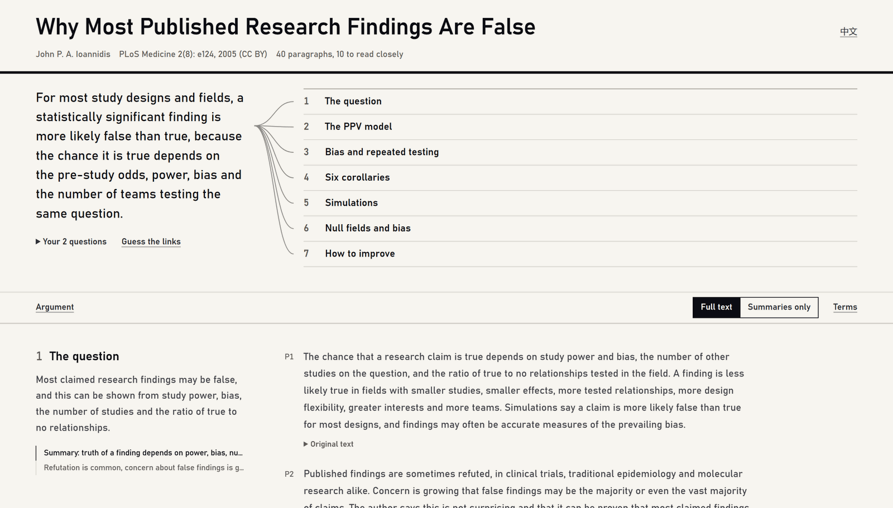
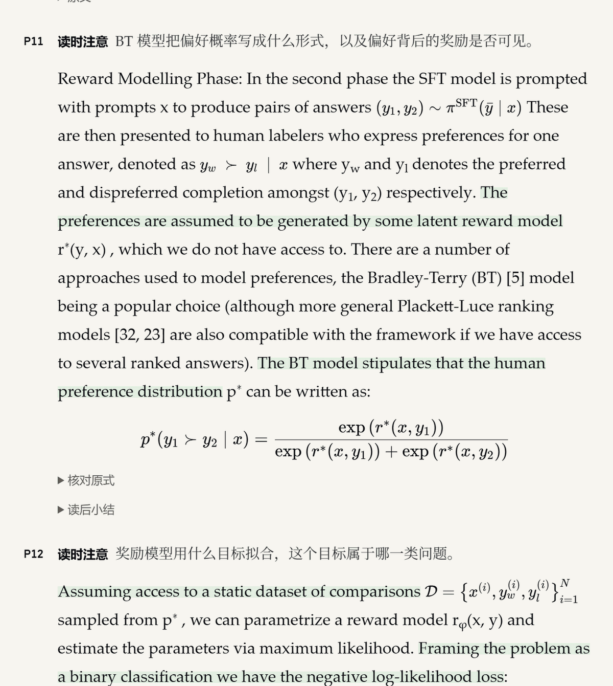

English | [中文](README.zh.md)

# reading-guide

**Turn a course reading into a page that teaches you how to read it.** Give an AI agent a PDF; get back one offline HTML page with the argument mapped, every paragraph sorted into close read / skim / skip, the key sentences highlighted in the original, formulas and tables cropped from the PDF and explained, and recall questions at the end of each part. Notes in English or Chinese.





The screenshots come from guides to Ioannidis (2005), [Why Most Published Research Findings Are False](https://doi.org/10.1371/journal.pmed.0020124), PLoS Medicine 2(8): e124 (CC BY), and Rafailov et al. (2023), [Direct Preference Optimization](https://arxiv.org/abs/2305.18290) (CC BY 4.0). The skill follows the open [Agent Skills](https://agentskills.io) format, so it works in any agent that supports skills; the scripts are plain Python and the page is a single file that works offline.

## Installation (30-second setup)

<details open>
<summary><b>Claude Code</b></summary>

```bash
git clone https://github.com/Liangzhen-Chen/literature-guide-read ~/.claude/skills/reading-guide
pip install -r ~/.claude/skills/reading-guide/requirements.txt
```

Then open any project, attach or name a PDF, and say "give me a reading guide for this".
</details>

<details>
<summary><b>Codex</b></summary>

```bash
git clone https://github.com/Liangzhen-Chen/literature-guide-read ~/.codex/skills/reading-guide
pip install -r ~/.codex/skills/reading-guide/requirements.txt
```
</details>

<details>
<summary><b>Any agent that supports Agent Skills (Cursor, Copilot, Gemini CLI, …)</b></summary>

```bash
npx skills@latest add Liangzhen-Chen/literature-guide-read
pip install pdfplumber beautifulsoup4   # beautifulsoup4 is only needed for open versions (arXiv)
```

The installer asks which agents to install to; the default is the current project, and `-g` installs at user level.
</details>

<details>
<summary><b>claude.ai</b></summary>

Zip the folder and upload it through the Skills control if your plan has one. Only the default extraction tier runs there (the sandbox cannot download models); scans and formula-heavy readings do better in a local agent.
</details>

<details>
<summary><b>By hand, with any chat model</b></summary>

Run the scripts yourself; the model only writes the guide data.

```bash
pip install -r requirements.txt
python scripts/segment.py reading.pdf --out work
```

Give the model the files in `references/` and `work/paragraphs_part*.txt`, with this prompt:

> Write guide data for this reading. The rules are in method.md, elements.md and genres.md; the format is in schema.md. The text is already split into numbered paragraphs: use those ids and do not re-split. Read every paragraph first, then follow method.md. Write the notes in [Chinese/English]. Output only two JSON blocks, saved as guide.json and paras_01.json. Copy every anchor verbatim from the original.

Save the two blocks into `work/`, then:

```bash
python scripts/check.py work/paragraphs.json work/guide.json work/paras_01.json
python scripts/render.py work/paragraphs.json work/guide.json work/paras_01.json --out work/guide.html
```

If `check.py` reports errors, paste them back to the model and ask it to fix them.
</details>

Optional, for scans and formula-heavy readings: Tesseract (`eng`, `chi_sim`) and Poppler for OCR; [MinerU](https://github.com/opendatalab/MinerU) for layout analysis (`pip install "mineru>=4,<5" && mineru-kit models download --tier basic`, about 0.8 GB, CPU is fine). `segment.py` uses MinerU automatically when it is installed; see [Extraction tiers](#extraction-tiers).

## Usage

1. Give the agent a PDF and ask for a reading guide.
2. It asks one round of questions first: the language of the notes, what you are reading for (the whole argument, core claims only, method and design, evidence to cite, exam revision), how familiar you are with the field, and any questions you want answered. Say "you decide" to take the defaults.
3. It segments the PDF, reads everything, writes the guide, validates it and hands you the page.

What you get on the page:

- A title, a source line (paragraph count, how many are close reads) and a one-sentence conclusion. Under it a mind map that doubles as the contents: one row per part, click a row to open its reasoning steps, dashed lines for qualifications. Your questions, answered from the text with paragraph links, and a "guess the relations" switch sit below.
- The original in order. Close-read paragraphs carry a "read for" prompt and a folded after-reading summary. Skim paragraphs lead with a restatement and fold the original. Skip paragraphs take one line. A switch shows full text or summaries only.
- One highlight style for definitions and key claims. Defined terms and symbols show their definition on hover.
- Simple formulas are set as text; complex ones render in KaTeX, with the PDF crop, an explanation and the symbol table folded under them. Figures and tables hang on the paragraph that first cites them.
- Recall questions at the end of each part, answers folded. Chinese, English or both, light and dark mode.

### What one reading costs

Measured with Claude Sonnet, running the skill from the PDF to the finished page: Ioannidis (2005), 6 pages, 40 paragraphs, notes in Chinese and English, took about 134,000 tokens and 7 minutes. The DPO paper (arXiv 2305.18290), 10 pages of main text, 52 paragraphs, 11 display equations, notes in Chinese, took about 172,000 tokens and 10 minutes. These are the totals Claude Code reports, which count the context it re-reads on every turn; with pay-per-token billing, cached input is cheaper.

While you read, ask the agent about any paragraph ("what is P23 saying?"), correct a tier or a note, or say "walk me through it" to go part by part.

## How it works

1. `segment.py` splits the PDF into fixed paragraph ids (P1, P2, …), recognises headings, captions and footnotes, removes running heads, records printed page numbers, links footnotes to the paragraphs that cite them, and crops every display equation and table region. Single- and two-column layouts (three columns or a side column need MinerU), scans (OCR) and Chinese headings and footnotes are handled.
2. `sources.py` (optional) fetches the arXiv HTML or TeX version of a paper for clean figures, tables and formulas.
3. The agent reads every paragraph and writes the guide data: parts and claims, the relations between parts, a tier and a note or "read for" line per paragraph, elements anchored to verbatim spans, formula transcriptions checked against the crops, recall questions.
4. `check.py` reports an error, and `render.py` writes no page, when a paragraph has no entry, parts do not cover the text in order, an anchor is not verbatim in the paragraph, a number in a note is not in the source, or LaTeX braces are unbalanced. It only warns about numbers inside a formula's `tex`, a close-read share above the density cap, and notes that only describe a paragraph without restating its content.
5. `render.py` builds the single-file page.

The rules the agent follows are in `references/method.md`, `elements.md`, `genres.md` and `schema.md`; they are plain text and meant to be edited as you learn what your readings need.

## Extraction tiers

| | Default | With MinerU |
| --- | --- | --- |
| Install | `pip install pdfplumber` | plus MinerU and its basic models (about 0.8 GB) |
| Running heads, headings, tables | heuristics on the text layer | layout analysis; tables as structure |
| Display formulas | located by heuristics, cropped | located by the layout model, cropped; transcribed to LaTeX when the formula model is installed |
| Speed on a CPU | seconds per paper | 1 to 3 minutes per paper |

Measured on a private set of 11 readings (seven real publications, scans and a textbook chapter; the set is not distributed with this repository, so the figures cannot be re-run from it): on manually reviewed pages MinerU ties or beats the default on 7 of 8, removes all 30 running heads the default used to turn into headings on a JSTOR scan, and turns about 800 loose table rows into 111 tables. On four formula-heavy papers (machine learning, econometrics, quantum computing, pure mathematics) MinerU found about twice as many display equations as the default. Without MinerU's 577 MB formula model, formulas come out as crops that the agent transcribes; that run is 40% to 75% faster.

## Why it reads this way

The design follows published studies of reading interfaces and learning:

- Faceted highlights let readers find information faster without losing accuracy, but wrong or dense highlights cost trust ([Scim, Allen AI](https://dl.acm.org/doi/fullHtml/10.1145/3581641.3584034)). So the page has one highlight style, sparse and validated, and a summaries-only view.
- Definitions at the point of use help readers of dense papers ([ScholarPhi](https://dl.acm.org/doi/fullHtml/10.1145/3411764.3445648)). So definitions show on hover.
- Argument mapping improves critical thinking, and the gain comes from working the map out yourself ([van Gelder](https://www.reasoninglab.com/wp-content/uploads/2013/10/TvG-Using-argument-mapping-to-improve-critical-thinking-skills-2015.pdf)). So there is a "guess the relations" switch.
- Pre-questions help on the material they target ([prequestion meta-analysis](https://link.springer.com/article/10.3758/s13423-023-02353-8)) and retrieval practice is the best-supported study method ([Dunlosky et al. 2013](https://doi.org/10.1177/1529100612453266)). So the "read for" prompts are specific and each part ends with recall questions. Each close read also has a folded after-reading summary, so you try to recall the paragraph before you check it.
- Explaining a worked example to yourself beats reading the explanation ([self-explanation](https://link.aps.org/doi/10.1103/PhysRevPhysEducRes.18.010136)). So formula explanations stay folded until you open them.

## Files

| File | What it holds | Edit it when |
| --- | --- | --- |
| `SKILL.md` | the workflow and the rules the agent must keep | the workflow changes |
| `references/method.md` | the method: parts, tiers, notes, elements, numbers, recall | refining the method (most edits go here) |
| `references/elements.md` | element types; `check.py` and the page read them from here | adding or renaming types |
| `references/genres.md` | adjustments by genre | a new genre comes up |
| `references/schema.md` | the guide data format with examples | rarely |
| `scripts/segment.py` | segmentation | segmentation goes wrong |
| `scripts/mineru_backend.py` | the optional MinerU engine and the rules applied to its output | MinerU output needs a new rule |
| `scripts/crops.py` | crops of formula and table regions | crop sizing changes |
| `scripts/sources.py` | open versions | open-version handling changes |
| `scripts/check.py` | validation | adding a check |
| `scripts/render.py` | page assembly; `--dump` recovers data from a page | rarely |
| `assets/template.html` | the page | changing the page |
| `CHANGELOG.md` | every change and what prompted it | every change |

Tests: `python -m pytest tests/unit` (Python 3.9 and 3.12). Every fix to the scripts is covered by a regression test that failed before the fix.

## Known limits

- Segmentation is heuristic on the default tier: equations, tables, metadata and unusual layouts can still split or merge paragraphs. Spot-check the part files before the guide is written; the paragraph ids are frozen after that.
- The default tier handles single- and two-column layouts only. Three columns or a side column (for example the 2005 PLOS Medicine layout) need MinerU.
- With MinerU, inline formulas in prose appear in the original paragraph as the LaTeX source MinerU returns; the page does not render them, and the original paragraph is never edited. Without MinerU's formula model they stay as the PDF text layer gives them. Display formulas are shown as crops beside their transcription.
- On three-column layouts, MinerU can cut a paragraph at a column or page break. There is no tool to merge the pieces yet, so the notes are written for the paragraphs as cut.
- Open versions are fetched only for arXiv papers, and only where the network allows.
- A page embeds the full text of the PDF it was built from. Keep pages made from copyrighted readings to yourself; use openly licensed papers for public demos.

## License

MIT. KaTeX (MIT) is vendored under `assets/katex/`; see `THIRD_PARTY_NOTICES.md`.
