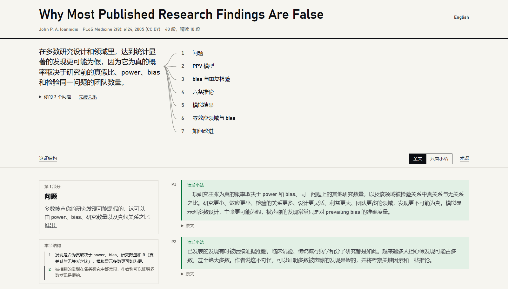
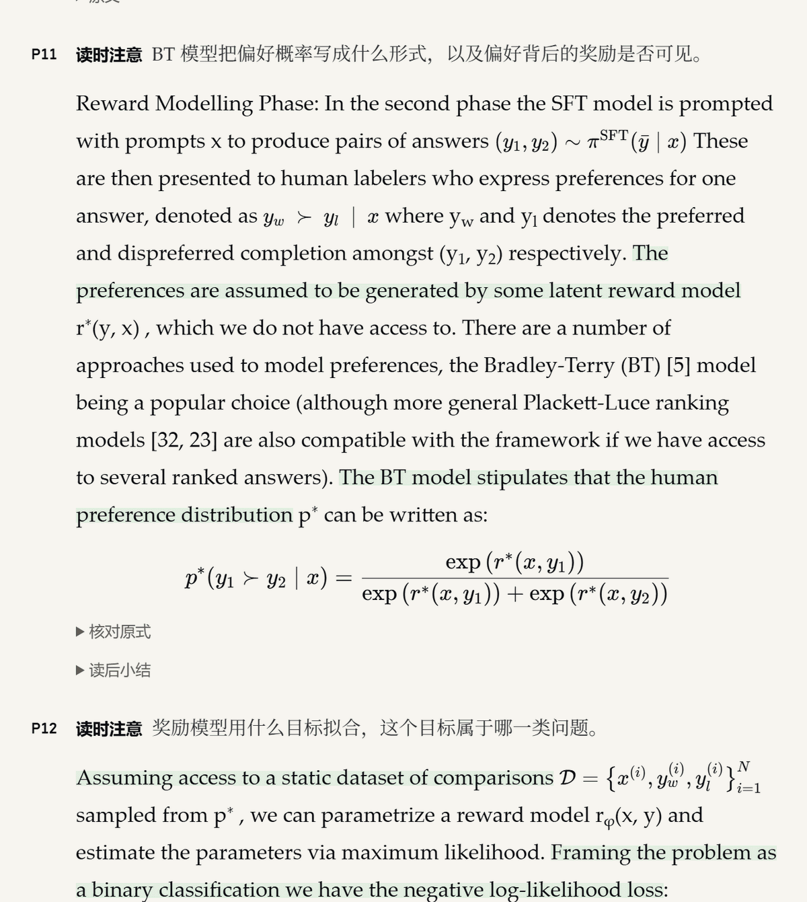

[English](README.md) | 中文

# reading-guide

**把论文交给 AI agent，拿回一张页面：哪段要精读、哪段略读、哪段可以跳过，一眼看清。**

reading-guide 是一个读课程读物和论文用的 agent skill。Agent 先把整份 PDF 读完，再围绕原文做出一张离线网页，笔记可以是中文、英文或双语。Claude Code、Codex、claude.ai 和其他支持 [Agent Skills](https://agentskills.io) 的工具都能用。

直接打开做好的页面：[Ioannidis（2005），中英双语笔记](https://liangzhen-chen.github.io/literature-guide-read/)，或 [DPO 论文（2023），中文笔记](https://liangzhen-chen.github.io/literature-guide-read/dpo.html)。



## 你会得到什么

- **先看结论。** 页面最上面一句话写清结论，下面一张思维导图，画出各部分怎样支撑它。
- **知道时间花在哪。** 每段都标好精读、略读或可跳过。时间不够就切到"只看小结"，照样能跟上论证。
- **左栏帮你记住读到哪。** 读的时候，左栏显示当前部分的论点、带编号的推理步骤（每步一句）和这一部分定义的术语，点一下步骤就跳到原文。
- **原文一字不改。** 导读写的内容都放在浅色底的框里，任何时候都分得清哪句是作者说的。
- **公式看得懂。** 关键公式渲染出来并加解释，附符号表和 PDF 上的裁图，方便核对。
- **边读边练。** 精读段有"读时注意"，读完可以展开小结对一下；每部分末尾有回想题。
- **回答你的问题。** 开始前告诉 agent 你想弄清什么，页面从原文里作答，并链接到对应段落。
- **笔记可信。** 生成页面前，检查脚本会拦下两种错误：笔记里出现原文没有的数字，或者标出的句子和原文对不上。



## 安装

<details open>
<summary><b>Claude Code</b></summary>

```bash
git clone https://github.com/Liangzhen-Chen/literature-guide-read ~/.claude/skills/reading-guide
pip install -r ~/.claude/skills/reading-guide/requirements.txt
```
</details>

<details>
<summary><b>Codex</b></summary>

```bash
git clone https://github.com/Liangzhen-Chen/literature-guide-read ~/.codex/skills/reading-guide
pip install -r ~/.codex/skills/reading-guide/requirements.txt
```
</details>

<details>
<summary><b>其他支持 Agent Skills 的工具（Cursor、Copilot、Gemini CLI 等）</b></summary>

```bash
npx skills@latest add Liangzhen-Chen/literature-guide-read
pip install pdfplumber beautifulsoup4
```

安装器会问装到哪些 agent；加 `-g` 装到用户级，不加则装到当前项目。
</details>

<details>
<summary><b>claude.ai</b></summary>

从 [最新 Release](https://github.com/Liangzhen-Chen/literature-guide-read/releases/latest) 下载 `reading-guide.zip`，在 Settings → Capabilities → Skills 上传。扫描件和公式多的论文在本地 agent 里效果更好。
</details>

<details>
<summary><b>手动，配合任意聊天模型</b></summary>

脚本自己跑，模型只负责写导读数据。

```bash
pip install -r requirements.txt
python scripts/segment.py reading.pdf --out work
```

把 `references/` 里的文件和 `work/paragraphs_part*.txt` 给模型，配这段提示词：

> 为这篇读物写导读数据。规则在 method.md、elements.md、genres.md，格式在 schema.md。正文已经切成编号段落：用这些编号，不要重新切。先读完每一段，再按 method.md 写。笔记用[中文/英文]。只输出两个 JSON 块，分别存为 guide.json 和 paras_01.json。每条锚句逐字从原文复制。

把两个 JSON 存进 `work/`，然后：

```bash
python scripts/check.py work/paragraphs.json work/guide.json work/paras_01.json
python scripts/render.py work/paragraphs.json work/guide.json work/paras_01.json --out work/guide.html
```

`check.py` 报错就把错误贴回给模型让它改。
</details>

<details>
<summary><b>可选：扫描件、三栏排版、公式很多的论文</b></summary>

扫描件需要 Tesseract（`eng`、`chi_sim`）和 Poppler。三栏排版和公式多的论文装上 [MinerU](https://github.com/opendatalab/MinerU) 效果更好，装好后 skill 会自动使用（约 0.8 GB，CPU 即可）：

```bash
pip install "mineru>=4,<5" && mineru-kit models download --tier basic
```
</details>

更新：在 skill 文件夹里运行 `git pull`，或重新运行一次 `npx` 那行，claude.ai 上则重新上传新的 zip。

## 用法

1. 给 agent 一份 PDF，说"帮我做这篇的导读"。
2. 它先问几个问题：笔记用中文还是英文；为什么读（整体理解、只要核心论点、看方法、找证据引用、备考）；对这个领域熟不熟；有没有想弄清的问题。说"你定"就按默认来。
3. 几分钟后拿到页面。用 Claude Sonnet 实测：6 页的论文约 7 分钟、13.4 万 token；10 页、11 条公式的论文约 10 分钟、17.2 万 token。

读的时候可以问 agent 任何一段（"P23 在说什么？"），让它改某条笔记，或者说"带我过一遍"让它逐部分讲。

## 依据阅读研究设计

- 只用一种高亮，而且标得少，另有只看小结的视图：过密或标错的高亮会让读者不再信任它（[Scim](https://dl.acm.org/doi/fullHtml/10.1145/3581641.3584034)）。
- 术语在用到的地方悬停显示释义（[ScholarPhi](https://dl.acm.org/doi/fullHtml/10.1145/3411764.3445648)）。
- 思维导图有"先猜关系"开关：论证图在自己动手推的时候最有用（[van Gelder](https://www.reasoninglab.com/wp-content/uploads/2013/10/TvG-Using-argument-mapping-to-improve-critical-thinking-skills-2015.pdf)）。
- "读时注意"写得具体，每部分有回想题，小结要先回想再展开：依据前置问题（[元分析](https://link.springer.com/article/10.3758/s13423-023-02353-8)）和提取练习（[Dunlosky 等 2013](https://doi.org/10.1177/1529100612453266)）的研究。
- 公式解释默认折叠，让你先自己试着解释这一步（[self-explanation](https://link.aps.org/doi/10.1103/PhysRevPhysEducRes.18.010136)）。

## 已知限制

- 最适合有文字层的单栏或双栏 PDF。版式特殊时，个别段落可能被切成两段或和下一段连在一起；agent 写导读前会先抽查切段。
- MinerU 识别的行内公式可能带少量识别错误。行间公式都附有 PDF 裁图，可以对照核对。
- 页面里嵌有生成它的 PDF 的全文。用受版权保护的读物生成的页面只留给自己看。

Agent 遵守的规则是 `references/` 里的纯文本；读得多了，可以直接改，也可以告诉 agent 哪里不对。演示用的两篇论文都是开放许可：Ioannidis（2005）[Why Most Published Research Findings Are False](https://doi.org/10.1371/journal.pmed.0020124)（CC BY），Rafailov 等（2023）[Direct Preference Optimization](https://arxiv.org/abs/2305.18290)（CC BY 4.0）。

## 许可

MIT。KaTeX（MIT）内置在 `assets/katex/`，详见 `THIRD_PARTY_NOTICES.md`。
